# Manual del panel · 85 BARBERÍA

Guía para quien administra la barbería día a día. No necesitas saber de programación.

> Las capturas usan citas y nombres de demostración, no datos reales.

- **Dirección del panel:** `https://<tu-dominio>/login` (en pruebas: `http://localhost:3000/login`).
- **Funciona en celular, tablet y computadora.** En el celular el menú está abajo; "Más" abre el resto de las opciones.
- Cada cambio muestra un aviso abajo/arriba de la pantalla: verde si se guardó, rojo si algo falló (con el motivo).

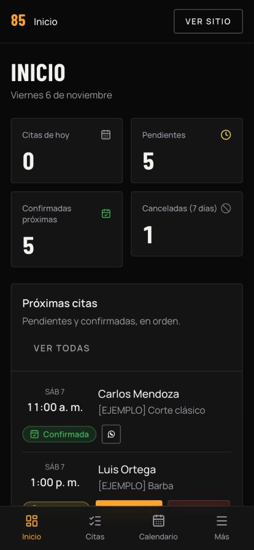

---

## 1. Entrar y salir

1. Abre `/login`, escribe tu correo y contraseña y toca **Entrar**. El ícono del ojo junto a la contraseña la muestra u oculta para revisar que esté bien escrita.
2. Para salir: **Cerrar sesión** (barra lateral; en el celular, dentro de **Más**).
3. ¿Olvidaste la contraseña? Pídele a otra persona con rol **Administración** que te ponga una nueva en **Usuarios → Contraseña**. Si eres la única cuenta de administración, quien dio soporte técnico puede restablecerla.

> Nunca compartas tu contraseña por chat o correo. Cada persona debe tener su propia cuenta.

## 2. Roles

| Rol | Puede |
|---|---|
| **Recepción** | Ver el inicio, atender citas (confirmar, rechazar, cancelar, completar, notas, WhatsApp), ver el calendario, ver el horario y poner o quitar bloqueos de agenda |
| **Administración** | Todo lo anterior, además de servicios, barberos, horario de atención, contenido del sitio, configuración y usuarios |

### Si tu cuenta es de Recepción

Tu menú solo muestra **Inicio, Citas, Calendario y Horarios**, y arriba a la derecha aparece la etiqueta **Recepción**. Atiendes las citas igual que en las secciones 3 a 5.

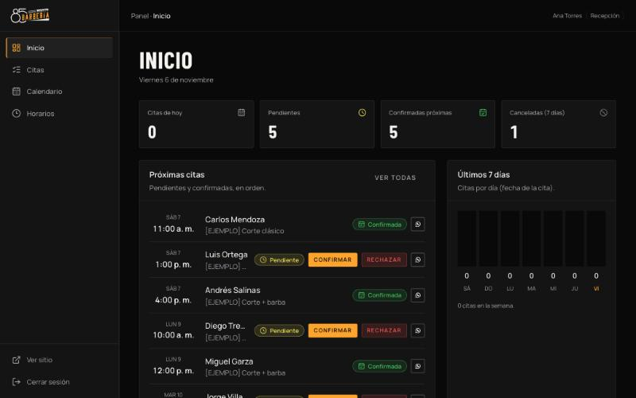

En **Horarios** ves el horario de atención (sin poder cambiarlo) y puedes **agregar o quitar bloqueos de agenda**.

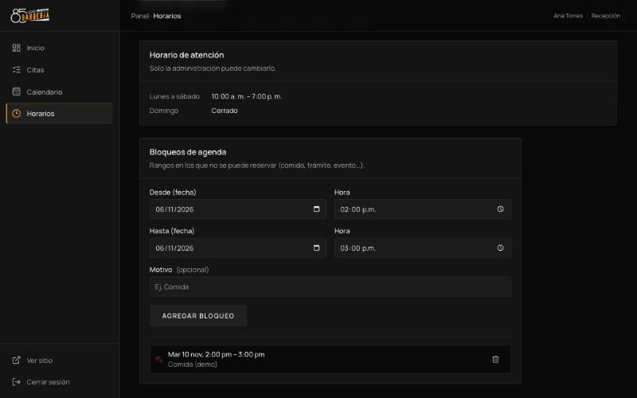

Si abres una sección de administración (por ejemplo, desde un enlace), el panel te regresa al inicio con este aviso:

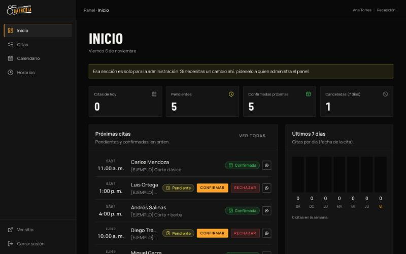

En el celular, **Más** solo muestra **Horarios** y **Cerrar sesión**.

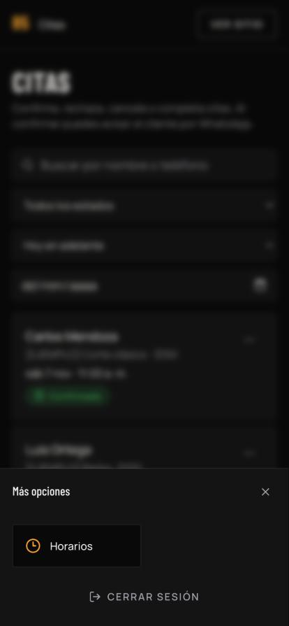

## 3. Inicio

- **Citas de hoy, Pendientes, Confirmadas próximas, Canceladas (7 días).** Toca una tarjeta para ver esas citas.
- **Próximas citas:** confirma o rechaza desde aquí, o toca el nombre para ver el detalle.
- **Últimos 7 días:** cuántas citas hubo cada día, por color de estado.

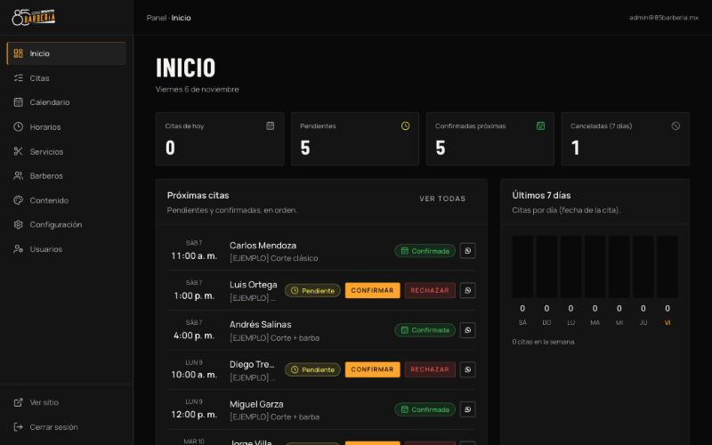

## 4. Citas

### Estados

| Estado | Qué significa |
|---|---|
| 🟡 **Pendiente** | El cliente la pidió desde el sitio. Aparta el horario unas horas mientras la revisas |
| 🟢 **Confirmada** | La aceptaste. El horario queda reservado |
| 🔵 **Completada** | El servicio ya se hizo |
| 🔴 **Rechazada** | No la aceptaste; el horario se libera |
| ⚪ **Cancelada** | Se canceló después de pedirla o confirmarla; el horario se libera |
| ⚫ **Vencida** | Nadie la confirmó y su hora ya pasó (se marca sola cada día) |

### Confirmar una cita (lo más común)

1. Ve a **Citas** (o al **Inicio**) y busca la solicitud **Pendiente**.
2. Toca **Confirmar** y acepta en la ventana de confirmación.
3. Aparece el botón **WhatsApp**: ábrelo y envía el mensaje ya escrito al cliente. *(El sistema no envía mensajes solo; tú decides cuándo enviarlo.)*
4. Si otras personas habían pedido ese mismo horario, el panel te ofrece **rechazarlas** de una vez.

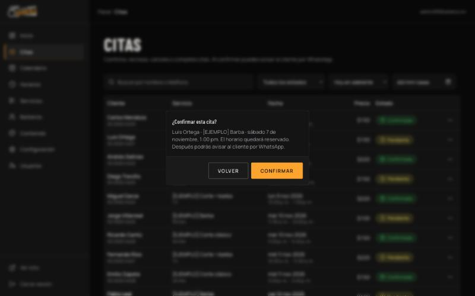

### Otras acciones

- **Rechazar:** no puedes atender esa solicitud. Avísale al cliente por WhatsApp desde el detalle.
- **Cancelar:** una cita (pendiente o confirmada) que ya no va. Libera el horario.
- **Completar:** después de atender al cliente (solo se habilita cuando ya pasó su hora de inicio).
- **Notas internas:** en el detalle de la cita. Solo las ve el equipo, nunca el cliente.
- **Historial:** en el detalle ves quién cambió el estado y cuándo.

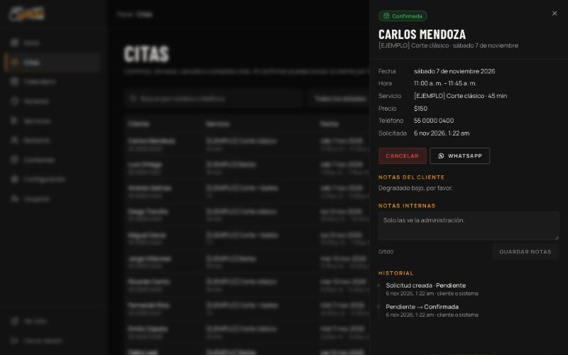

### Buscar

Arriba de la tabla: busca por **nombre o teléfono**, filtra por **estado**, por **periodo** (hoy en adelante, pasadas, todas) o por **fecha**. **Limpiar** quita los filtros.

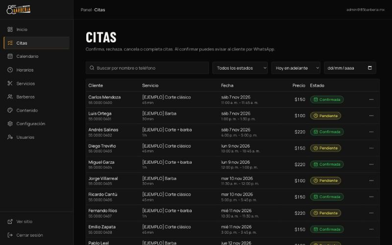

### Mensajes de error frecuentes

| Mensaje | Qué hacer |
|---|---|
| "Otra cita confirmada ya ocupa ese horario" | Ya confirmaste a alguien a esa hora. Rechaza esta solicitud o cancela la otra |
| "Hay un bloqueo de agenda en ese horario" | Quita el bloqueo en **Horarios** si quieres atenderla |
| "La cita ya cambió de estado" | Otra persona la atendió. Recarga la página |

## 5. Calendario

- **Mes / Semana / Día** arriba a la derecha (en el celular, abajo). **Hoy** regresa a la fecha actual.
- Los colores son los de los estados. Las chips de arriba muestran u ocultan estados (por ejemplo, ocultar las canceladas).
- Las **franjas rayadas** son bloqueos de agenda; las zonas más oscuras, horas en que la barbería está cerrada.
- Toca una cita para abrir su detalle con las mismas acciones de **Citas**.

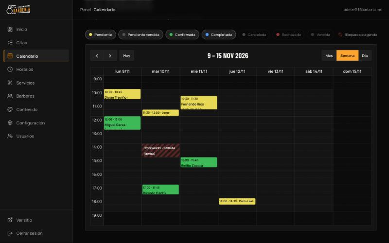

## 6. Horarios

- **Horario semanal** *(Administración)*: activa o desactiva cada día y pon el horario. **Agregar rango** sirve para cerrar a la hora de comida (por ejemplo, 10:00–14:00 y 15:00–19:00). Toca **Guardar horario**.

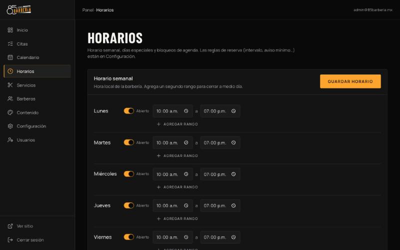
- **Días especiales** *(Administración)*: un festivo o vacaciones (**Cerrado**) o un día con **Horario especial**. Ese día reemplaza al horario semanal.
- **Bloqueos de agenda** *(Recepción y Administración)*: aparta un rango para que nadie reserve (trámite, comida, evento). Puede abarcar varios días. **Ojo:** un bloqueo no cancela las citas ya confirmadas en ese rango; el panel te avisa si hay alguna para que decidas.

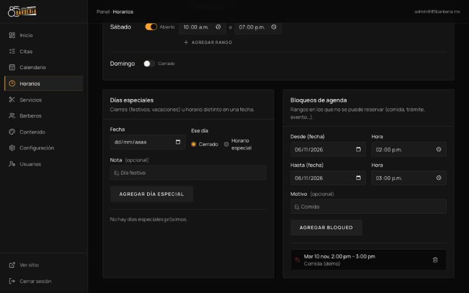

## 7. Servicios *(Administración)*

- **Nuevo servicio:** nombre, descripción, precio, duración (en múltiplos de 5 minutos) y foto opcional.
- **Activo:** si lo apagas, el servicio desaparece del sitio y de la reserva, pero las citas que ya lo usaron se conservan.
- **Flechas ↑ ↓:** cambian el orden en el sitio.
- **Eliminar:** solo funciona si el servicio nunca se ha reservado. Si ya tiene citas, **desactívalo**.
- Los cambios de precio no afectan a las citas ya pedidas: cada una guarda el precio con el que se solicitó.

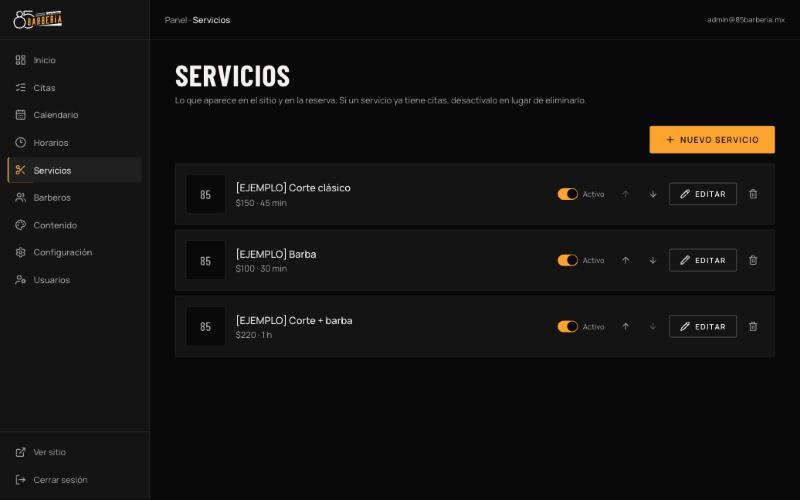

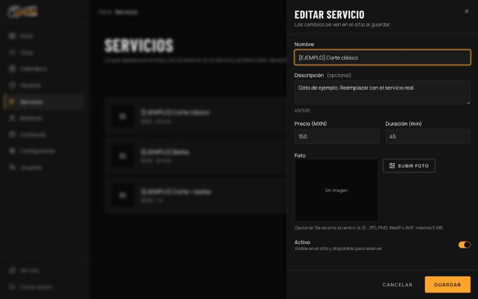

## 8. Barberos *(Administración)*

- Alta con nombre, especialidad, descripción y foto.
- **Horario:** días y horas en que trabaja cada barbero (con días de descanso y varios rangos por día). Hoy sirve para organizar al equipo; los clientes todavía no eligen barbero al reservar.

## 9. Contenido del sitio *(Administración)*

Todos los textos y fotos del sitio público, por pestañas: **Portada, Servicios, Cómo reservar, Nosotros, Galería, Contacto, Llamado final, Reservaciones y Buscadores (SEO).**

- Cada campo muestra el **texto original** como referencia y un contador de caracteres.
- **Restaurar original:** vuelve al texto de fábrica (dejar el campo vacío hace lo mismo).
- **Fotos:** **Subir foto / Cambiar / Quitar**. JPG, PNG, WebP o AVIF de hasta 5 MB. Llena también la **descripción de la foto**: la leen los lectores de pantalla y Google.
- **Cómo reservar:** cada paso puede llevar una foto de fondo (se ve en blanco y negro y a color al pasar el cursor). Sin foto, la tarjeta queda lisa.
- **Galería:** **Subir fotos** (varias a la vez), describe cada una, cambia el orden con las flechas, ocúltala con **Visible** o elimínala. Sin fotos visibles, la sección no aparece en el sitio.
- Toca **Guardar** en cada pestaña. Los cambios se ven en el sitio de inmediato (recarga la página del sitio).
- **Ver sitio** abre la página pública en otra pestaña.

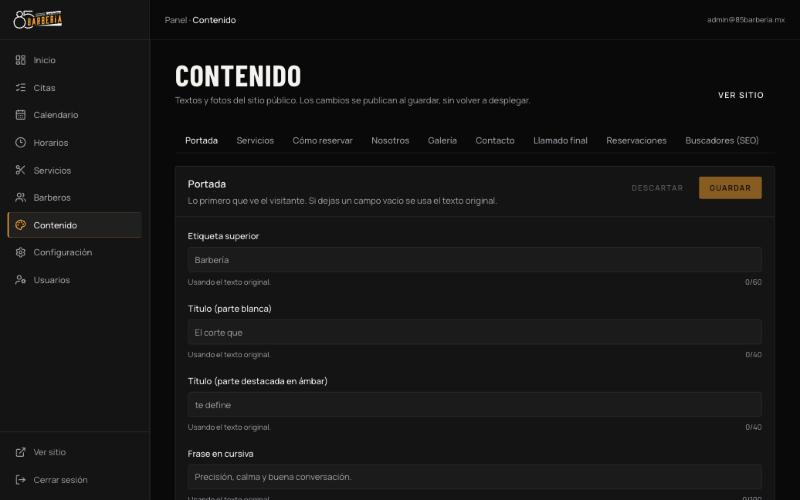

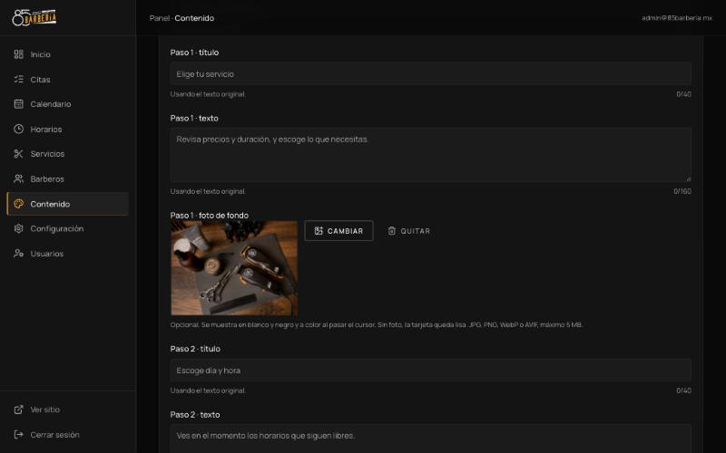

**Fotos recomendadas:** portada vertical (4:5) de al menos 1200 px de alto; "Nosotros" horizontal (4:3); galería de 6 a 8 fotos de cortes e instalaciones. Las fotos que vienen de ejemplo son de Unsplash; lo ideal es reemplazarlas por fotos reales de la barbería.

## 10. Configuración *(Administración)*

- **Negocio y contacto:** nombre, dirección, ciudad, teléfono, **WhatsApp** (10 dígitos) y enlace de Google Maps. Con el WhatsApp capturado aparece el botón en Contacto y al terminar una reserva. Estos datos también aparecen en el aviso de privacidad y los términos.
- **Redes sociales:** escribe `@usuario` o pega el enlace completo.
- **Reglas de reserva:**
  - *Intervalo entre horarios:* cada cuánto se ofrece un horario (por ejemplo, cada 30 minutos).
  - *Aviso mínimo:* con cuánta anticipación mínima se puede reservar.
  - *Anticipación máxima:* hasta cuántos días adelante.
  - *Retención de pendientes:* cuánto tiempo una solicitud sin confirmar aparta el horario.
  - *Pendientes por teléfono:* cuántas solicitudes abiertas puede tener un mismo número (evita abusos).
- **Guardar cambios** aparece cuando modificas algo; **Descartar** deshace.

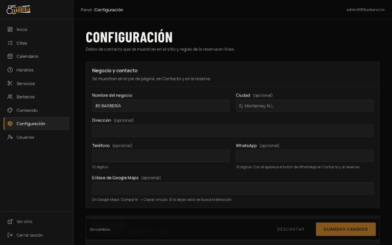

## 11. Usuarios *(Administración)*

- **Nueva cuenta:** nombre, correo, contraseña inicial (12+ caracteres) y rol. Entrégale la contraseña en persona.
- **Rol:** cambia entre Recepción y Administración.
- **Contraseña:** pon una nueva si alguien la olvidó.
- **Eliminar:** la persona deja de tener acceso; sus citas atendidas se conservan.
- No puedes cambiar tu propio rol ni eliminarte (así nunca se queda la barbería sin administrador).

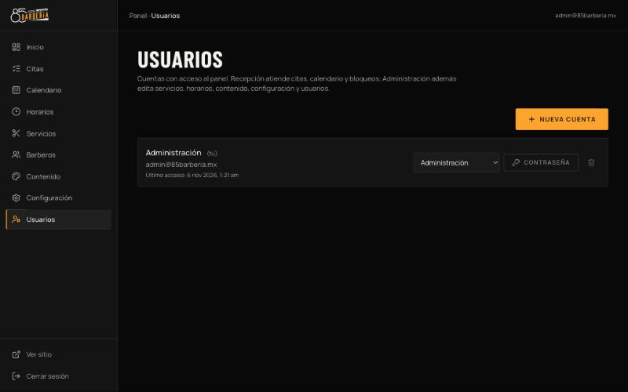

## 12. Si algo falla

1. Recarga la página. Si sigue, cierra sesión y vuelve a entrar.
2. Si una acción muestra un error en rojo, lee el motivo: casi siempre indica qué hacer (ver tablas de arriba).
3. Si el sitio no carga o no deja reservar: anota la hora y qué estabas haciendo y contacta a soporte técnico.
4. Los datos se respaldan cada semana (ver `docs/08-respaldos.md`).

## 13. Accesos del negocio (sin contraseñas)

Guárdalos en un lugar seguro (gestor de contraseñas). Ninguno debe compartirse por chat.

| Servicio | Para qué |
|---|---|
| **Vercel** | Donde vive el sitio (despliegues, dominio, analítica) |
| **Supabase** | Base de datos, fotos y cuentas del panel |
| **GitHub** | Código del sitio y respaldos semanales |
| **Dominio** | El nombre del sitio (proveedor donde se compró) |
| **Frase de respaldos** | Sin ella no se pueden abrir los respaldos |
